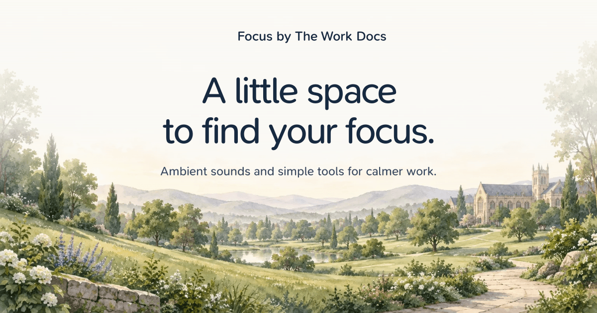

# Moodist + The Work Docs

A little space to find your focus.

A free focus companion by **The Work Docs team**, built on the open-source
[Moodist](https://github.com/remvze/moodist) project. Mix ambient sounds, set aside
time for focused work, and keep your notes and next steps close.

[Open Moodist + The Work Docs](https://focus.theworkdocs.com) ·
[Explore The Work Docs](https://www.theworkdocs.com)



## Features

- **84 ambient sounds** from nature, rain, animals, places, and more. Layer sounds
  and adjust their volume to build your own soundscape.
- **Ready-made and saved mixes**, favorites, sound search, and shareable mix links.
- **A persistent tool dock** for timers, notes, tasks, and breathing exercises.
  Open a compact panel while continuing to use the page.
- **Quick focus sessions** with 15-, 25-, and 50-minute presets, custom durations,
  short and long breaks, and pause/resume controls.
- **Day and dusk garden artwork**, light and dark themes, and locally served SN Pro
  typography.
- **More listening options** including binaural beats, isochronic tones, lo-fi
  music, internet radio, and a sleep timer.
- **An installable PWA** with offline caching for bundled assets. Internet radio
  and YouTube playback need an internet connection.

## Focus tools

The dock stays available as you scroll. On mobile, it becomes a horizontal row
above the sound controls.

| Tool | What it does |
| --- | --- |
| Focus | Start a Pomodoro session or break, choose a preset, or enter custom minutes. |
| Notes | Write, copy, download, and save a note in your browser. |
| Tasks | Add, edit, complete, and remove tasks. |
| Flow | Track a focus session and calculate a break from the time spent working. |
| Timer | Start a 5-, 15-, or 30-minute countdown, or set hours, minutes, and seconds. |
| Breathe | Follow a guided breathing pattern. |

Timers keep running when their panels are minimized or another tool is open.
Pomodoro accounts for elapsed time when you return from a background tab.
Timer sessions are not restored after a page reload.

Notes, tasks, saved mixes, and settings are stored in your browser. No account is
needed.

## Local development

Use **Node.js 24** and **pnpm**. Node.js 24 is the runtime used to verify this
project.

From the repository root:

```bash
pnpm install --frozen-lockfile
pnpm dev
```

Open the URL printed by Astro, normally [localhost:4321](http://localhost:4321).

To build and preview the static site:

```bash
pnpm build
pnpm preview
```

The production build is written to `dist/`.

### Checks

```bash
pnpm check
node --test tests/pomodoro.test.mjs
```

The timer tests cover elapsed time after a background delay, pause/resume, mode
changes, completion handling, and duration validation.

## Deploy on Vercel

Import this repository into Vercel and deploy the branch containing your changes.
Use these project settings:

| Setting | Value |
| --- | --- |
| Framework | Astro |
| Root directory | Repository root (`.`) |
| Install command | `pnpm install --frozen-lockfile` |
| Build command | `pnpm build` |
| Output directory | `dist` |
| Node.js version | 24.x |

The app builds as a static site and does not require application environment
variables or a backend server.

Add **`focus.theworkdocs.com`** as the project's domain in Vercel and complete its
DNS configuration. The `site` value in `astro.config.mjs` is already set to
`https://focus.theworkdocs.com`; canonical URLs and social image URLs use this
address. Update it if you deploy under a different domain.

## Project guide

| Location | Purpose |
| --- | --- |
| `src/pages/index.astro` | Landing-page composition. |
| `src/components/hero.astro` | Moodist + The Work Docs branding and hero. |
| `src/components/workdocs-promo.astro` | Introduction and link to The Work Docs. |
| `src/components/focus-dock/` | Persistent shortcuts to the focus tools. |
| `src/components/toolbox/` | Timer, note, and task interfaces. |
| `src/stores/` | Sound, timer, and browser-persisted state. |
| `src/layouts/layout.astro` | Page metadata, canonical URL, and OG/Twitter tags. |
| `public/images/hero/` | Responsive day and dusk garden images. |
| `public/fonts/` | Locally served font files. |
| `public/og.png` | 1200 × 630 social preview image. |
| `assets/og.svg` | SVG source for the social preview image. |
| `tests/pomodoro.test.mjs` | Pomodoro timing regression tests. |

## Contributing

See [CONTRIBUTING.md](CONTRIBUTING.md) for contribution guidelines.

## Credits and license

This project is based on [Moodist](https://github.com/remvze/moodist), created by
[Maze](https://github.com/remvze). The Work Docs edition adds its visual identity,
website links, and the persistent focus-tool dock.

The code is licensed under the [MIT License](LICENSE). The original copyright
notice is retained in `LICENSE`.

Some audio assets have separate licenses:

- [Pixabay Content License](https://pixabay.com/service/license-summary/)
- [CC0](https://creativecommons.org/publicdomain/zero/1.0/)
